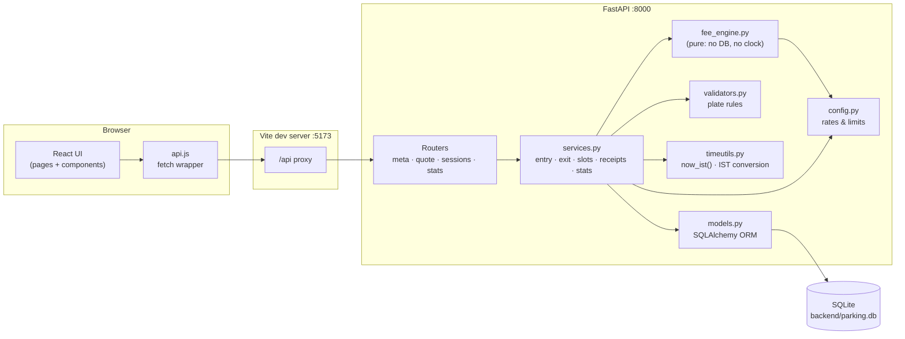
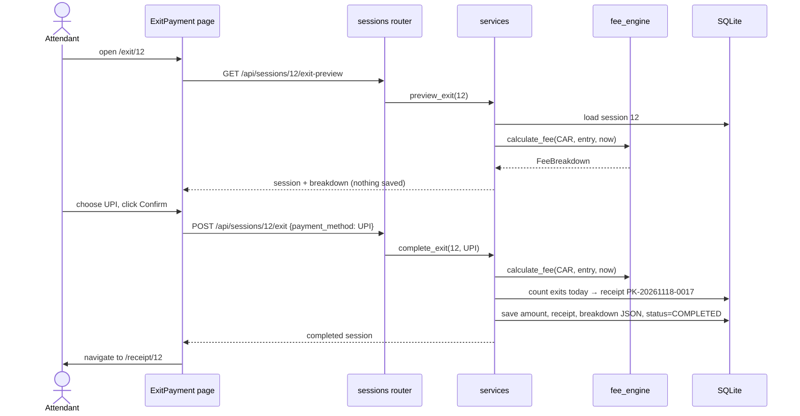

# Architecture

## Components



| Layer | Files | Job |
|---|---|---|
| UI | `frontend/src/pages/*`, `components/*` | Screens for the attendant. Shows whatever the API returns. Never calculates a fee itself. |
| API client | `frontend/src/api.js` | `api.get` / `api.post`. Throws `Error(detail)` so pages can show the backend's message. |
| Routers | `backend/app/routers/*` | Read the request, call one service function, return a schema. No business logic. |
| Schemas | `backend/app/schemas.py` | Pydantic models: request validation and response shape (datetimes go out with `+05:30`). |
| Services | `backend/app/services.py` | Business rules: one active session per plate, lowest free slot, receipt numbers, stats. |
| Fee engine | `backend/app/fee_engine.py` | Pure function `calculate_fee(type, entry, exit) → FeeBreakdown`. |
| Validators | `backend/app/validators.py` | `normalize_plate()` and `is_valid_plate()`. |
| Time utils | `backend/app/timeutils.py` | `now_ist()` (the only clock read), `to_ist_naive()`, `to_iso_ist()`. |
| Models / DB | `backend/app/models.py`, `db.py` | The `parking_sessions` table and the SQLite connection. |
| Config | `backend/app/config.py` | Every rate, limit and capacity. |

## Request flow: confirming an exit



When a session becomes `COMPLETED` its slot is free again, because a slot counts as taken only
while a `PARKED` session uses it.

## Data model

Table **`parking_sessions`**: one row per visit.

| Column | Type | Notes |
|---|---|---|
| id | INTEGER PK | autoincrement |
| vehicle_number | TEXT, indexed | normalized, e.g. `WB02AB1234` |
| vehicle_type | TEXT | `BIKE` / `CAR` / `SUV` |
| slot_code | TEXT | e.g. `C-07` |
| status | TEXT, indexed | `PARKED` / `COMPLETED` |
| entry_time | DATETIME, indexed | naive IST |
| exit_time | DATETIME, nullable, indexed | naive IST |
| duration_minutes | INTEGER, nullable | set on exit |
| billable_hours | INTEGER, nullable | set on exit |
| amount | INTEGER, nullable | rupees, set on exit |
| payment_method | TEXT, nullable | `CASH` / `UPI` |
| receipt_no | TEXT, nullable, unique | `PK-YYYYMMDD-NNNN` |
| fee_breakdown | TEXT (JSON), nullable | full breakdown snapshot at exit |
| created_at | DATETIME | |

Rules enforced:

- **One active session per vehicle.** `services.create_entry` checks this first so it can return a friendly 409 message. A partial unique index (`uq_parked_vehicle`, `WHERE status = 'PARKED'`) also enforces it inside the database.
- **One vehicle per slot.** Same approach: lowest free slot in `find_free_slot`, plus the partial unique index `uq_parked_slot`.
- **Receipt number.** `PK-{exit date}-{number of exits that date + 1, 4 digits}`. The column is unique.
- **Breakdown snapshot.** The receipt shows the breakdown saved at exit, so changing a rate later never changes an old receipt.

## Time handling

| Where | Form |
|---|---|
| Browser input (`datetime-local`) | `2026-11-18T21:00`. The frontend adds `:00+05:30` before sending. |
| API in | Any ISO 8601. `to_ist_naive()` converts it to IST and removes the offset. |
| Inside the app and in SQLite | Naive datetimes that mean IST. |
| API out | `to_iso_ist()` adds the offset back: `2026-11-18T21:00:00+05:30`. |
| Browser display | `utils/format.js` formats in `Asia/Kolkata`, whatever timezone the laptop is set to. |

`now_ist()` in `timeutils.py` is the only place that reads the clock. The fee engine never reads
it, so its tests always give the same result.

## Frontend structure

```
frontend/src/
  api.js                 fetch wrapper: get/post, throws Error(detail)
  utils/format.js        formatINR, formatDateTime, formatElapsed, datetime-local helpers
  hooks/                 useConfig (cached rate card), useInterval (auto-refresh), useDebounced
  components/            Sidebar, StatCard, FeeBreakdown, VehicleTypePicker, LiveTimer, Toast,
                         EmptyState, Icon, PageHeader, TypeBadge, MethodPill
  pages/                 Dashboard, NewEntry, ParkedVehicles, ExitPayment, Receipt, History,
                         Simulator, RateCard
  App.jsx, main.jsx, index.css
```

Live data: the Dashboard, Parked Vehicles and Exit preview refetch every 30 seconds. The elapsed
timer on Parked Vehicles ticks every second in the browser. The fee itself always comes from the
server.
